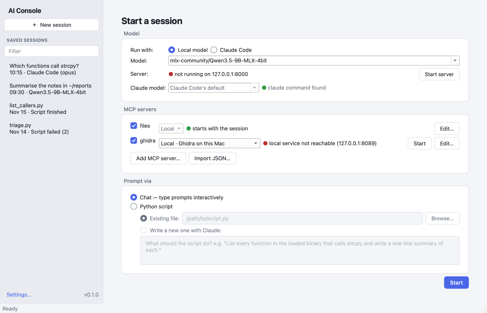
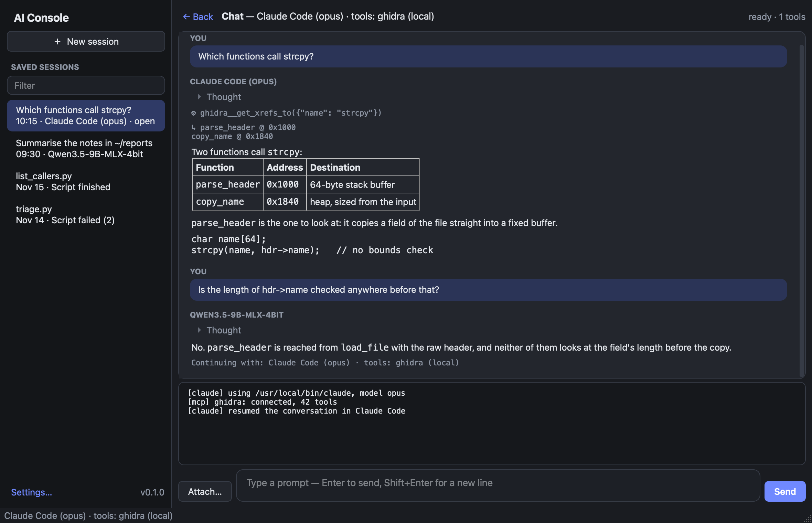

# AI Console

## Prelude

Claude models have been a pain to work with to get help with a lot of the cyber tooling
I use due to the nature of it. I also wanted to be able to use a front end framework to
get some experience with it. Due to Claude giving me access to fable without paying
for usage credits for a week and a project deadline coming up that I wanted to be able to
use this idea for, I opted to use Fable 5.2 to write this for me.

This is not the end of the project as I hope to improve it and iron out all of the details
to both add much more functionality and make it nicer to use. It looks slightly clunky as
of now, but it works. The idea is that I can choose whichever model/provider I want
based on what I have access to, including open source models. MacBook Pros have a lot
of memory, which makes running LLMs on them somewhat feasible depending on the size. Further
testing needs to be done to determine the usefulness of a locally running model when
attempting to run more difficult tasks, but it's worked well for the tasks I've run so far.

The big test will be to see if I can get it to help me build a ROP chain for my binary
exploitation class. Regardless, this will help.

*Where does this go from here?*

I'm going to be fixing the appearance, making this work on Linux, and then greatly
expanding the functionality of the MCP controls. The current dashboard is nowhere near
where it should be, but it at least works in maintaining the health of the MCP servers
as well as running and stopping them when they're no longer needed (including when the
application is shut down). The dashboard will also serve as the way to manage the models
running locally. It's important to note that this can manage remote MCP servers, and I
would like to expand that to include models hosted by the user on other machines (such as
a remote server over a tailnet, for example).

## Details

A macOS desktop console for running a model with [MCP](https://modelcontextprotocol.io) tools.
Pick who answers (a local model behind any OpenAI-compatible server, or Claude
Code), tick the MCP servers it may use, then chat or run a Python script.

- **Any local model server**: vllm-mlx, mlx-lm, Ollama, LM Studio, llama.cpp, or
  anything else that speaks the OpenAI API. The app can start the server for you
  and shows its log.
- **Claude Code as a backend**: the same chat, answered by the `claude` CLI with
  your existing login and no API key.
- **MCP servers, local or remote**: add them from a form, a preset, or the JSON
  snippet from a server's README. A server that needs a background service
  (also on another machine, over ssh) gets a status light and a Start button.
- **Saved sessions**: every chat and script run is kept and can be reopened.
  Leave a conversation, come back to it, or continue it with a different model
  or different tools.
- **Model and effort per conversation**: swap who answers from inside the chat
  (one local model for another, Claude Fable 5.2 / Opus 5.5 / Sonnet 5.5 /
  Haiku 5.5, or between the two kinds), and set how hard it thinks on a scale.
- **Tidy exit**: closing the app stops what it started: the model server, the
  agent and its MCP servers, services and ssh tunnels.
- **Everything visible**: model server, ssh tunnels, agent and scripts each
  have a live log.





## Quick start

You need macOS, the Xcode command line tools (`xcode-select --install`),
[Homebrew](https://brew.sh) and Python 3.10 or newer.

```zsh
git clone <this repository> && cd <its folder>
brew install qt                                  # Qt 6
python3 -m pip install -r requirements.txt       # the MCP client used by the agent
make run                                         # builds bin/ai_console and starts it
```

Then, in the app:

1. **Model server.** Open **Settings…** (bottom left, or ⌘,) and choose your
   provider; see [Model servers](#model-servers). Skip this if you only want
   Claude Code.
2. **MCP servers.** On the start page, **Add MCP server…** and pick a preset
   (`files` is a good first one: read-only access to your home folder), or
   paste a snippet with **Import JSON…**.
3. Tick the servers to use, choose *Local model* or *Claude Code*, and press
   **Start**.

If something needed is missing (Python can't import `mcp`, the server command
isn't installed), the start page says so at the top.

`CMakeLists.txt` is kept in step for IDE use
(`cmake -B build -DCMAKE_PREFIX_PATH="$(brew --prefix qt)" && cmake --build build`);
the tests are run through the Makefile.

## Model servers

**Settings… → Model server** decides where the model is and how *Start server*
starts it. Choosing a provider fills in the fields; every field can then be
edited.

| Provider | Address | Start command | Model looks like |
|---|---|---|---|
| vllm-mlx (default) | `http://127.0.0.1:8000/v1` | `vllm-mlx serve {model} --enable-auto-tool-choice --tool-call-parser auto --port {port}` | `mlx-community/Qwen3.5-9B-MLX-4bit` |
| mlx-lm | `http://127.0.0.1:8080/v1` | `mlx_lm.server --model {model} --port {port}` | `mlx-community/Qwen3.5-9B-MLX-4bit` |
| Ollama | `http://127.0.0.1:11434/v1` | `ollama serve` | `qwen3:8b` |
| LM Studio | `http://127.0.0.1:1234/v1` | `lms server start --port {port}` | whatever is loaded |
| llama.cpp | `http://127.0.0.1:8080/v1` | `llama-server -hf {model} --jinja --port {port}` | `ggml-org/gemma-3-4b-it-GGUF` |
| Other | any URL | none | — |

- `{model}` is the model chosen on the start page; `{port}` and `{host}` come
  from the address.
- With no start command the app starts nothing and only shows whether the
  address answers. Use that for a server you start yourself, or one on another
  machine. An **API key** can be given for a server that wants one.
- A server started with *Start server* is stopped when the app closes (see
  [Closing the app](#closing-the-app)). The **stop command** is only for a
  server that keeps running after its start command has returned, as LM
  Studio's does (`lms server stop`).
- A start command with `{model}` in it serves that one model. When a chat
  moves to another local model, a server started from the app is started again
  with the new one, and the chat's next message waits until it answers.
- The **Models** list is what the Model box offers; anything else can be typed
  there. When a server is running, the models it reports are added.
- The commands and model names above are starting points. Check your server's
  own documentation, in particular for what it needs to make **tool calls**
  work (a model that supports them, and for some servers a flag such as
  `--jinja`). Without tool calls a chat still works, but MCP tools are not used.

The same dialog sets which **Python** runs the agent (point it at a virtual
environment's `python` if that is where you installed the requirements), where
the **claude** CLI is, and the folder generated scripts go to.

## Claude Code

Choose **Run with: Claude Code** on the start page. The chat works the same way,
but replies come from the `claude` CLI, so no model server is needed.
[Install Claude Code](https://claude.com/claude-code) and log in once from a
terminal (`claude`, then `/login`). **Claude model** lists the current models
by name and number (Fable 5.2, Opus 5.5, Sonnet 5.5, Haiku 5.5), each pinned
to exactly that model; any other model name or alias (`opus`, `sonnet`, …) can
be typed, and left empty, Claude Code uses its default.

- **Tools.** Claude gets the MCP servers ticked for the session and nothing
  else: Claude Code's own tools (shell, file editing, web) are switched off,
  and MCP servers configured in Claude Code itself are not loaded. Nobody can
  answer a permission prompt from the chat window, so the session's MCP tools
  are approved up front and anything else is refused.
- **Reasoning.** By default Claude Code only reports *that* Claude is
  reasoning, not what. The app asks it for a summary of the reasoning and shows
  that in the same collapsed *Thinking* block a local model's reasoning gets.
  With a Claude Code version that can't provide it, the block still appears
  ("Thought for N s · reasoning not shown").
- **Where it runs.** In its own empty folder (`claude_workspace` in the app's
  data folder), so no project's `CLAUDE.md` is picked up. Claude Code keeps its
  own copy of each conversation there, which is what lets a chat be resumed
  exactly; deleting a session in the app does not delete that copy.
- `claude` is looked for on the `PATH`, in `~/.local/bin` and `~/.claude/local`,
  then inside the VS Code extension. Settings can point at another one.
- Python scripts always use the local model.

## MCP servers

No server is built in. Servers live in `mcp_servers.json` in the app's data
folder and are managed from the start page:

- **Add MCP server…** opens a form. "Start from" offers the presets in
  `presets/` (edit hosts and paths before saving).
- **Import JSON…** takes the configuration snippet most servers publish in
  their README.
- **Edit…** on a row changes or deletes that server.

Changes are saved immediately and survive restarts.

### File format

The file uses the same `mcpServers` layout as other MCP clients:

```json
{
  "mcpServers": {
    "files":  { "command": "python3", "args": ["${APP_PYTHON}/mcp_files.py", "--root", "${HOME}"] },
    "search": { "type": "http", "url": "https://example.com/mcp",
                "headers": { "Authorization": "Bearer ..." } }
  }
}
```

`type` is `stdio` (default when there is a `command`), `http` (streamable
HTTP) or `sse`. Values may use `${HOME}` and `${APP_PYTHON}` (this project's
`python/` folder).

Two optional additions are specific to this app:

**`service`** — the server needs a background service running first. The row
gets a status light and a Start button.

```json
"service": {
  "host": "user@build-box",      // ssh destination; leave out for "this Mac"
  "port": 8089,                  // port the service listens on, on that machine
  "localPort": 18089,            // remote only: port on this Mac forwarded to it
  "start": "ghidraRun",          // optional: shell command that starts it there
  "healthPath": "/",             // optional: HTTP path used to check it is up
  "infoPath": "/mcp/instance_info",   // optional: printed in the log once up
  "logFile": "~/service.log",    // optional: new lines are copied into the log
  "hint": "..."                  // optional: shown if it isn't up after a minute
}
```

The service must answer HTTP on its port. `${SERVICE_URL}` and
`${SERVICE_PORT}` in the server's command, URL, environment or headers stand
for where the service is reached on this Mac. For a remote service, Start
opens **one ssh connection** that starts the service if needed, forwards the
port, and shows the log; nothing has to be installed on the remote machine
beyond ssh access with a key. Stop closes the watcher (and the tunnel) and
leaves the service running. Closing the app is different: a service that was
started from the app is stopped with it, also on the remote machine, while
one that was already running when you pressed Start is left alone.

**`locations`** — the same tool can run in more than one place, and the start
page offers a dropdown. Each entry is a server entry of its own plus an `id`
and a `label`:

```json
"ghidra": {
  "locations": [
    { "id": "local",  "label": "Local",  "command": "...", "service": { "port": 8089 } },
    { "id": "remote", "label": "Remote", "command": "...", "service": { "host": "user@box", "port": 8089, "localPort": 18089 } }
  ]
}
```

Give each location its own port on this Mac (as above), so two can be up at
once and one is never reported as the other. See `presets/ghidra-mcp.json`
for a complete example.

### Presets

| Preset | What it is |
|---|---|
| `files` | A small read-only files server that ships with this project (`python/mcp_files.py`): list, read and search under your home folder. |
| `ghidra-mcp` | [bethington/ghidra-mcp](https://github.com/bethington/ghidra-mcp) 7.x, with a local and a remote location. |
| `hexstrike` | [HexStrike AI](https://github.com/0x4m4/hexstrike-ai) running on another machine, reached over ssh. Security testing tools: only point them at systems you are authorised to test. |

For the Ghidra preset, the "service" is the GhidraMCP plugin inside a running
Ghidra; the location chooses *which Ghidra* the tools talk to. You need a
checkout of that repository on this Mac (the preset assumes `~/ghidra-mcp`; it
must be the same release as the plugin) and the GhidraMCP extension installed
in the Ghidra you want to use. Starting Ghidra on a remote machine needs
someone logged in at its desktop, since Ghidra opens its window there. The
remote location runs the bridge with `--tcp-only` so it never falls back to a
Ghidra that happens to be open on this Mac.

## Chat

- **Enter** sends, **Shift+Enter** starts a new line.
- While a reply is being written, **Send** becomes **Stop** (or press Esc).
  What was written so far is kept, in the transcript and in what the model sees
  next.
- **Attach…** adds files to the next message: images go to the model as images
  (large ones are scaled down first), text files are inlined, and other files
  are passed as a path that a tool can open.
- Answers are rendered as Markdown; each tool call and its result is shown as
  one line.
- Under the input are the **model picker** and the **effort scale**. Both apply
  from your next message on, in the same conversation; see below.

### Changing the model

Pick another entry in the model picker: one of your local models, or Claude
Code with its default model, Fable 5.2, Opus 5.5, Sonnet 5.5 or Haiku 5.5. The
model you switch to gets the whole conversation, and each answer in the
transcript is labelled with the model that wrote it.

- From one local model to another, or one Claude model to another, the change
  is immediate.
- Between a local model and Claude Code the other backend is started on the
  saved conversation, which takes a few seconds (it reconnects the MCP
  servers).
- The local models listed are the ones in Settings plus what the running
  server reports. A server that serves one model at a time is restarted for
  the new one if the app started it; see [Model servers](#model-servers).

### Effort

The scale sets how much the model thinks before it answers. **Default** says
nothing and leaves it to the model.

| | Levels | What is done |
|---|---|---|
| Claude Code | Low · Medium · High · Extra high · Max | Claude Code's own effort setting (`--effort`). Changing it restarts Claude Code, which resumes its copy of the conversation. |
| Local model | Off · Low · Medium · High | Off switches a thinking model's reasoning off. The other levels ask for reasoning at that level, and Low and Medium also cap it. |

There is no single way to ask an OpenAI-compatible server for this, so a
request carries the fields the common servers read (`reasoning_effort`,
`chat_template_kwargs.enable_thinking`, `thinking_token_budget`) and each
server uses the ones it knows. How much difference a level makes therefore
depends on the server and the model; a server that refuses the request because
of these fields is asked again without them. The level is saved with the
conversation, and the start page has the same scale for a new one.

The model's reasoning is kept out of the answer and shown as a collapsed
**Thinking…** block (click to open) that turns into "Thought for N s" when the
answer starts. For a local model, reasoning is recognised whether the server
sends it separately (`reasoning_content`), the model wraps it in
`<think>…</think>`, or only a closing `</think>` appears because the model's
chat template opens the tag itself. In that last case the first reply of a
model is corrected once it is recognised, and the app remembers the model
behaves that way (`model_traits.json` in the data folder).

Some servers add tools while running (the Ghidra bridge loads tool groups on
request); the agent re-reads the tool list after every tool call.

## Saved sessions

Every chat and every script run is saved as it happens and listed in the
sidebar, most recently used first. Click one to open it; right-click to rename
or delete it; type in **Filter** (⌘F) to narrow the list.

- **Chats** come back with their whole transcript (thinking, tool calls,
  attachments) and can be continued. A chat that was cut off mid-reply (the
  app quit, the agent was stopped) is marked as interrupted and continues from
  there.
- **Script runs** come back with their output; **Run again** runs the script
  again and replaces the saved output.

One chat is *open* at a time, and it keeps running while you look at other
pages: **← Back** takes you to the start page without stopping it, so you can
start a service, read a server log, or run a script, and then return with
**Continue “…”** (or by clicking the chat in the sidebar). A reply that was
being written when you left carries on in the background.

To **add or remove MCP servers mid-conversation**, go Back, change the ticked
servers (and, if you like, the model and the effort), and press
**Continue “…”**. The agent restarts with the new settings and the same
conversation. The model alone can be changed without leaving the chat; see
[Changing the model](#changing-the-model). Either way it works between any
combination: one local model to another, local model to Claude Code, and back.

- A local model is always sent the complete conversation, tool calls included.
- Claude Code resumes its own session when the conversation has only ever been
  with Claude Code. If part of it happened with a local model, a new Claude
  Code session is started and given the conversation so far as text (long tool
  results shortened, earlier images left out).

## Closing the app

Closing the window or quitting (also with Ctrl-C in the terminal the app was
started from) stops everything the app started:

- the chat's agent and the MCP servers it runs, and a script that is running;
- services behind MCP servers that were started with their **Start** button,
  on this Mac or over ssh, and the ssh tunnels to them;
- the model server, if **Start server** started it, with everything it
  started in turn.

What you started yourself is not touched: a model server from a terminal, or a
service that was already running when the app first looked. If the app is
killed outright or crashes, the agent and its MCP servers still end by
themselves, but a model server or a service it started may be left running.

## Scripts

*Prompt via: Python script* runs a script of yours, or has Claude Code write
one from a description (it is saved to the scripts folder, shown, and run when
you press **Run script**). A script talks to the local model and the session's
MCP servers through one class:

```python
from agent import Agent

with Agent() as agent:            # reads $AI_CONSOLE_CONFIG (written by the app)
    print(agent.tools)            # e.g. ['ghidra__list_functions', ...]
    reply = agent.ask("Which functions call strcpy? One line each.")
```

`ask()` runs a complete turn including any tool calls and returns the answer
without the reasoning; streamed text goes to stdout, tool activity to stderr.
Scripts are run with `python/` on `PYTHONPATH` and these environment variables
set: `AI_CONSOLE_CONFIG`, `OPENAI_BASE_URL`, `OPENAI_API_KEY`, `MODEL`.

## Where things are kept

Nothing is written to the project folder. Everything of yours is in the app's
data folder, `~/Library/Application Support/AI Console/AI Console/`
(**Settings… → Open data folder**):

| | |
|---|---|
| `settings.json` | The Settings dialog. Absent until you change something; the defaults are then in effect. |
| `mcp_servers.json` | Your MCP servers. |
| `history/<id>/` | One folder per saved session: `meta.json` (kind, title, dates, the model, effort and servers it last ran with), and for a chat `messages.json` (the conversation, in OpenAI chat format plus a few `_`-prefixed keys of the app's own that are never sent to a model; attached images are stored inside it) and `claude.json` (which Claude Code session holds it), or for a script run `output.log`. Deleting a folder deletes the session. |
| `model_traits.json` | What the app has learned about how a model marks its reasoning. |
| `session.json`, `script_session.json`, `claude_mcp.json`, `claude_workspace/` | Working files for the session in progress. |

The choices on the start page (last model, effort, ticked servers) and the window's
size are in the macOS preferences (`com.ai-console.AI Console`).

## Safety

- The app runs what you configure: the model server's start command, MCP
  server commands, and ssh to the hosts you name. Read a preset or a pasted
  snippet before saving it.
- A model may call any tool of the MCP servers ticked for the session, without
  asking each time. Tick only what you would let it use.
- An API key entered in Settings is stored as plain text in `settings.json`.
- Conversations, including attached images and tool results, are stored
  unencrypted in the data folder.

## Tests

```zsh
make test
```

Builds two headless drivers from the app's own objects and runs them against a
fake model server and a fake `claude` CLI, so no model, login or network is
needed and none of your settings are touched. See [tests/README.md](tests/README.md).

## Troubleshooting

- **"can't import the mcp package"** on the start page: install the
  requirements with the Python the app uses
  (`python3 -m pip install -r requirements.txt`), or choose the right
  interpreter in Settings.
- **"Start server" fails at once / asks for a password.** The server is run as
  you, never with `sudo`. If it only works with `sudo` in a terminal, its files
  or its model cache were probably created by root; give them back to your user
  (for example `sudo chown -R "$USER":staff ~/.cache ~/.local`).
- **A program is not found although it works in your terminal.** Started from
  Finder, an app does not get your shell's `PATH`. The app adds `~/.local/bin`,
  `/usr/local/bin` and `/opt/homebrew/bin`; for anything elsewhere, give the
  full path in Settings (or start the app from a terminal with `make run`).
- **The model never uses tools.** The model or the server's settings don't
  support tool calls; see [Model servers](#model-servers).
- **Claude Code: "Not logged in".** Run `claude` in a terminal and `/login`.

## How it fits together

| Piece | Role |
|---|---|
| `src/`, `include/` (Qt, C++) | The console: start page, MCP server editor, settings, process logs, chat UI, saved sessions. Starts things and shows output; contains no model or tool logic. |
| `python/agent.py` | The agent runtime for a local model. Connects to the MCP servers and runs the model↔tool loop against an OpenAI-compatible API. Used by the chat page (JSON lines over stdin/stdout) and by scripts (`from agent import Agent`). |
| `python/claude_agent.py` | The same chat protocol, answered by Claude Code: runs one `claude -p` process that connects to the session's MCP servers itself. |
| `python/history.py` | The saved form of a conversation, shared by both backends. |
| `python/gen_script.py` | "Write a script with Claude": runs `claude -p` with the agent contract as system prompt and saves the result. |
| `python/service_watch.sh` | What a server's **Start** button runs when the server needs a background service: checks whether it is listening, starts it if not, prints what it reports about itself, copies new lines from its log, and keeps watching. Runs directly for a local service, or on the remote host through ssh. When the app closes it is told to stop the service it started. |
| `python/mcp_files.py` | The read-only files MCP server behind the `files` preset. |
| `python/ghidra_bridge.py` | Helper used by the Ghidra preset: starts the GhidraMCP bridge pointed at one specific Ghidra. |
| `presets/*.json` | Ready-made server entries offered in the Add dialog. |
| `include/Settings.h` | The settings and the provider presets. |
| `include/Commands.h` | How things are run: the environment child processes get, and every command line. |
| `include/LaunchConfig.h` | What a session is started with, the Claude models offered by name, and the effort levels each backend has. |
| `include/ProcessUtil.h` | How a child process is stopped together with everything it started. |
| `include/History.h` | Where saved sessions live on disk and what is in them. |
| `include/Style.h` | The app's look: one palette and one stylesheet, light and dark, following the system setting. |

The model server and the MCP server processes the agent talks to run on this
Mac; what can be local or remote is the *service behind* an MCP server (and a
model server you start yourself can be anywhere).

## Licence

[MIT](LICENSE).
